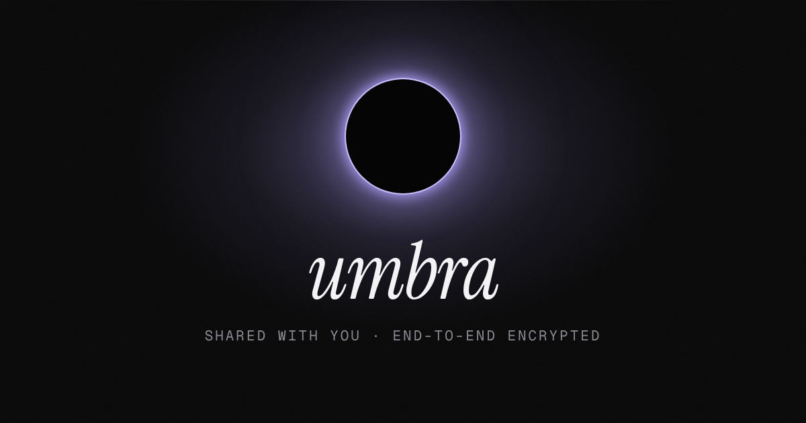

# umbra

**A quiet place to write — under a total eclipse.** A dark, cinematic note-taking site with a living light show, an optional to-do list, countdowns, and live, end-to-end encrypted sharing.



---

## What's inside

**The light show** *(the Galaxy scene — the default; see also Solar eclipse, Rain, Ink and Sky below)*
- A living sky behind everything (WebGL): a drifting nebula with glowing filaments and dark dust lanes, three depths of twinkling stars that shift with your cursor, and shooting stars — now and then a fireball or a little meteor shower.
- The editor is the moon in a total eclipse. A solar corona pours out from behind it in long, flowing streamers, swings toward your cursor, and throws off coronal loops. The side panels are smoked glass, so you see the sky through them.
- Your cursor is a light source: panels catch a rim of light where it passes, countdown cards tilt toward it and cast shadows away from it. (**Settings → Cursor light** turns it off, in any scene.)
- Writing: a caret made of light, letters that land white-hot and cool to ink, erased letters that fall away as ash, and a sunburst every 100 words. While you type, the sky calms down so it never gets in the way.
- **Eclipse** *(toggle, off by default)*: a total eclipse of its own, hanging in the galaxy — a black moon with the faintest earthshine on its night side, a thin pink thread of chromosphere round its limb with prominences flickering up off it, and the pearly corona streaming out into the nebula. Turning it on, the page's corona dims and the moon swells out of a point of light with its own; turning it off, the eclipse fades where it hangs and the light blooms back round the page — no gap, no jump. It glides to its new spot when the layout changes. **Where it hangs** *(appears once it's on)*: *Beside* your writing, in the open sky (where the solar eclipse hangs), or right in the *Middle* of the screen, behind your words. The diamond ring, the flares and the loops of plasma all happen on it; turn it off and the note is the moon again. Command palette: *Hang an eclipse in the galaxy*, *Move the eclipse to the middle*.
- **New note:** the diamond ring — a blinding flash on the moon's rim, lens flare, a shockwave through the sky.
- **Delete the open note:** the burning edge of the moon sweeps across the page, eating the old words, and the next note comes up out of the shadow behind it. The glass and the sky never change underneath. Anything else you delete dissolves into embers.
- **Check off a to-do:** a sunburst, then it burns away and its light streaks into *Completed*.
- **Share:** a beam of light goes up and the link decodes itself out of cipher glyphs. Your friend's page opens under a vast eclipsed moon; the note decrypts with a scanning line, the diamond ring flashes, and the corona flares whenever you edit.
- Plus: a short eclipse intro once per visit (followed by an invitation to sign in, if you aren't), a light trail when you switch notes, the new accent color flooding the screen from the swatch you clicked, a live clock (with optional milliseconds), and a sky that slowly wakes up if you leave it alone.
- **Settings → Effects:** *Max* (everything), *Subtle* (a calm sky and small flourishes) or *Off*. If your system asks for reduced motion, umbra uses *Subtle* automatically.
- **Settings → Transparency** *(right under Accent; it was called Background)*: how much of the scene shows through the panels, least to most — *Frosted* (smoked, frosted glass; was *Dark*), *Soft* (lighter, more of the sky; was *Glass*), *Clear* (the default: the sky almost fully, with a soft shade behind your words), *Outline* (no glass at all — just outlines over the open sky, with a crisp little drop shadow behind every word; was *Crystal*) or *Full* (nothing at all: no panels, no outlines, no shade — the sky's light even carries on behind your words instead of stopping at the page's edge; was *Bare*). Also in the command palette: *Show more of the sky*, *Frost the panels* and *Transparency: …*.
- **Settings → Title font:** the typeface of every note's title — *Display* (the tall, narrow serif), *Display italic*, *Serif*, *Sans* or *Mono*. Right-click a title to give just that note its own look (see *Notes*).
- On a phone, the status bar and the strip under the gesture bar take on the colors at the top and bottom of the sky, so it runs right to the edges of the screen.
- **Settings → About → Show version:** a small gray *v1.22* beside the logo, so a screenshot says which version it's from. The exact build (its commit and time) is listed there too, and in the command palette's *Screen info*. The number lives in `src/version.ts` and goes up with every update.

**Solar eclipse** *(Settings → Scene → Solar eclipse)*
- A real total solar eclipse, seen from the ground, drawn live on the GPU: a black moon in a golden, glowing ring, the pearly corona streaming out around it in long, fine-combed blades, pink prominences standing up off the rim, and a dusky sky with a sunset glowing all the way round the horizon — the way it really looks at totality. Venus and a few stars come out in the dark.
- It's alive: the fine rays stream outward all the time and sway as they go, bright knots of plasma flow out along the big streamers, a swell of light wanders slowly round the corona (leaning a little toward your cursor), the whole shape turns slowly over the minutes, the ring breathes, the prominences flicker and churn (with glowing knots raining down the great arch), and the moon wanders a hair to and fro, so the pink rim of fire slides round its edge.
- Where it hangs: with room beside your writing (and see-through panels), right there in the open sky, a little above the middle of the screen. With *Frosted* transparency, or no room, it's over the right-hand column instead, in the clear sky below your countdowns and to-dos (drifting down as the list grows). On a phone it's low on the right; on a friend's shared page it hangs over the note like a banner.
- **Look** *(Corona / Golden)*: *Corona* is all of the above. *Golden* is the photograph instead: a warm, smoky amber sky, a thin ring of fire round a dark umber moon, and the sun blazing out at one point up on its rim — a diamond ring that never quite goes away, breathing, with long horizontal streaks — and the clouds lit gold. Switching fades from one to the other. Choosing Golden (or arriving at a Golden eclipse from another scene) always turns the accent gold to match; pick another accent after and the whole eclipse — sky, ring of fire, glow and clouds — takes on its colors (with the gold accent it's exactly the original).
- **Corona color** *(Corona look)*: *Pearl* (how it really looks), *Gold*, *Ember*, *Rose*, *Violet*, *Ice* or *Mint* — the streamers, the glow and any eruptions take it on.
- **Distance** *(slider)*: bring it closer — all the way up, twice as close as it once could come, until it fills the sky beside your words — or send it further off. A small tick under the slider marks the usual distance: the slider settles onto it as you pass, and a double-click goes back to it. *Focus mode* brings it closer too: with the side columns put away, the eclipse stays where it hangs and grows nearer (its bright ring never reaching your words), and eases back when you come out.
- **Clouds** *(toggle)*: a bank of cumulus drifting slowly by underneath — dark in the moon's shadow, warm where the horizon glow catches their undersides, lying low under the sun so they frame it. Now and then a thin veil of high cloud crosses the sun and lights up, with a faint shimmer of color.
- **New note: the diamond ring.** The moon slips a hair off the sun: Baily's beads flicker along its mountainous edge, then the sunlight bursts out at one point — blinding, with a six-pointed star, a long lens streak, a rainbow halo and ghosts marching across the screen. The clouds light up gold, the corona dims in the glare, and it all fades as the moon slides back over.
- And now and then: a glimmer — the moon's edge slides a hair off the sun, and Baily's beads light up one after another along it (gentle enough to come while you write, too); a prominence erupts, with a vast, ghostly bubble of corona bursting out behind it (a coronal mass ejection); and if you leave it alone for a while, the full diamond ring.
- **The intro** plays the real thing in the middle of the screen: a strange, dimming daylight and a blinding crescent; the moon creeps over it; the beads, the diamond ring — totality, the corona blooming out, *umbra* below it. Then the sun drifts off to its place as the page comes up.
- Choosing it opens the scene out from the sun itself, and greets you with the diamond ring. Command palette: *Scene: Solar eclipse*, *Eclipse look: Golden / Corona*, and *Clear the clouds away*.
- The clouds are soft, so they're drawn at half resolution and only 30 times a second; the eclipse is drawn sharp on top. It's lighter on the GPU than the galaxy.

**Rain** *(Settings → Scene → Rain)*
- A night city seen through a rain-streaked window, all drawn live on the GPU — no images or video. The city is out of focus, the way it is when your eyes are on the glass: bokeh from windows, streetlamps, neon signs (one in your accent color), traffic sliding along a wet street with its reflections smeared down the road, blinking warning lights on the towers, mist, and rain falling through the lamplight.
- On the glass: beads of rain that land and slowly shrink away, and drops that gather, break free and run down in fits and starts — leaving a clear, glistening trail dotted with tiny beads. Every drop is a little lens: it shows the city upside down, small and sharp, with dark edges. The rest of the pane is fogged.
- Your cursor is a warm light held near the glass: drops glint as it passes and the fog glows around it.
- **Lightning** *(toggle)*: now and then a storm flickers in the clouds or a bolt comes down behind the skyline; every drop on the glass lights up and the room brightens for an instant. Never while you're typing, never more than three flickers a second, and never with reduced motion.
- **City lights** *(toggle)*: the city fades out, leaving just the rain and the dark.
- **How hard it rains:** *Drizzle* (clear glass, a few beads), *Rain*, or *Downpour* (misted up, drops running everywhere).
- **Blur:** how out of focus the city is — from crisp bokeh to a soft, dreamy glow (fully blurred by default). It's real defocus, worked out for every pixel (not a blurred picture), so it stays smooth at any setting; the rain outside softens a little less, and the drops on the glass always stay sharp.
- Drawn sharp: the glass at up to twice your screen's pixel density, the city at about its full resolution (and only 30 times a second, since it barely moves), the rain as fine anti-aliased streaks.
- Everything else goes wet too: a new note brings the lightning close; checking a to-do is a splash (ripples, a crown of droplets); erased letters run off the page like drips; deleting a note washes it away from the top; other things you delete are rinsed off in drops; sharing calls down a bolt; the intro writes *umbra* into the fogged glass; and the little sounds become drips and bubbles.
- It switches over with a sheet of rain running down the screen. Command palette: *Make it rain*, *Scene: Galaxy*, and toggles for lightning and city lights.
- Like the eclipse, it pauses completely when the tab is hidden and lowers its resolution on its own if a device struggles — but it keeps falling at full frame rate while you type.

**Ink** *(Settings → Scene → Ink — the light one)*
- Warm, paper-white, with real ink in real water all around your note — a true fluid simulation, drawn live on the GPU, no images or video. Every few seconds a drop of ink plunges in from the surface: it rolls up into a mushroom of curling ink, sinks, unfurls into billows and fine tendrils, and slowly hangs, thins and dissolves, settling along the bottom — while the next one falls somewhere else, now and then two together, so it never loops. The water keeps its own motion: drops tumble into each other's currents, and your cursor leaves eddies that carry on turning after it's gone.
- The ink is lit from above — deep, faintly blue-black where it's dense, translucent veils where it's thin, each billow casting a soft shadow on the paper behind it — and light from the surface plays over the paper in a bright, shifting net, the way sunlight does on the bottom of a pool (the paper a shade deeper than plain paper, so the light stands out; brightest near the surface, and never where the ink's shadow falls). It all moves a little slower than life: slow, heavy ink.
- **Behind your words**, it depends on the *Transparency*: *Clear* sees the ink softly through a frosted column — a smooth blur, as through frosted glass (it swirls at full strength in the margins either side); *Soft* sees it through the frosted pane of the note; *Outline* and *Full* have nothing over it at all — the ink passes right behind your words, and each word keeps its paper halo (and Full, as in every scene, has no panels, edges or cards anywhere — just your words over the water); *Frosted* keeps the note a sheet of heavy paper.
- **Ink detail** *(Settings → Ink detail: Standard / High)*: how finely the ink is drawn — *High* (three-quarters of the screen's resolution) by default; *Standard* (half) is lighter on the graphics card. (Starting the water is a burst of work; it's no longer held against the picture's resolution, which used to step down after it and stay there.)
- **Ink colours** *(Settings → Ink colours)*: charcoal and indigo, or *+ Accent* for drops of your accent colour among them too (a deep wine, a sea green — whatever your accent is, in ink).
- Finish a paragraph (<kbd>Enter</kbd>) and a drop of ink lets go into the water beside your words (one side, then the other; no more than one every few seconds).
- On a phone (or a tablet held upright), where your words fill the screen, a little ink goes a long way: the drops come in down the sides, a little less often and lighter, and dissolve sooner, so the middle stays clear whatever the *Transparency*.
- On a device that can't run the full simulation (no WebGL 2 with float textures), the lighter fluid-style ink from before: clouds blooming low and along the edges.
- The whole interface turns to ink on paper: ink-dark type, paper panels on soft, warm shadows, and every accent (and to-do color) in a deeper, inkier shade. Each *Transparency* has a paper version: *Frosted* frosts the panels like heavy paper, *Soft* lets more of the water through, *Clear* (the default) leaves your note on open water with the side columns as sheets of vellum, and *Outline* and *Full* clear nearly everything away (every word keeps a soft paper halo).
- **Arriving:** choose Ink and the screen fades to near-black — then, in the middle of the screen, the ink bursts open out of the dark in curling fingers as the paper clears around it, and it all settles into the live background. About two and a half seconds; a tap, a click or any key skips it, and changing scene again part-way calls it off cleanly.
- **Ink settling letters** *(toggle, off by default)*: each letter you type lands in wet ink — deep blue-black, a touch heavy, bleeding softly into the paper — and dries to the page's own tone in under a second, so the last few letters behind your caret are always still drying, the freshest the wettest, like writing with a fountain pen. It's drawn over the text, never in it — nothing moves or reflows, and your caret, selection, undo, paste, autocorrect and keyboard (IME and phone keyboards included) work exactly as always. The wet ink stays on its letters when a word wraps onto the next line or a line opens above, and goes the moment its letter does (Backspace, undo, a shortcut like `## `). Pasting, undo, a friend's edits and opening a note never do it. It's only ever a fade (nothing moves), so it stays with reduced motion too.
- Everything else is ink too: the caret is a nib of ink; a new note is a drop of ink blooming under the fresh page; deleting a note lets its words bleed away into the water; the little flourishes become flecks and strokes of ink; and the sounds turn to soft taps and drops.
- **The intro** (once a visit) is quiet: *umbra* soaks into the paper letter by letter while a cloud of ink opens out in the water beneath it.
- Light on the GPU: the water's current is solved on a coarse grid (an eighth of the screen's resolution) and the ink rides it at three-quarters resolution (by Ink detail), 20 times a second (the screen blends smoothly between steps; it runs slower than life by taking smaller steps, never fewer, so it stays smooth while you write); the paper is painted once. While you write, the water calms and fewer drops fall; leave it be and it livens up. It pauses when the tab is hidden, and with effects off it's simply paper.

**Sky** *(hidden for now, while it's being finished: search the command palette for "sky" to try it — a light one)*
- A summer sky the way anime films paint them, drawn live on the GPU — no images or video: a deep blue overhead melting into bright cyan at the horizon, the sun low and blazing with its rays fanning slowly across the sky, and clouds everywhere — great towers of cumulus heaped up at the sides, white where the sun catches them, lavender in their own shade and blushing pink along their edges; little fluffy clouds drifting across the middle (each one different, the nearer passing cleanly in front of the further); torn scraps here and there; long wisps of cirrus combed out up high; and a hazy bank along the horizon.
- It never stops moving: every layer rides the wind at its own pace (the towers nearest and quickest, the wisps far up and slow), and the clouds keep slowly changing shape as they go. While you write they ease off a little.
- Your cursor is a breath of wind: the clouds near it drift along the way it moves, and the nearer ones shift a little as it wanders, so the sky has depth. (*Settings → Cursor light* turns it off.)
- **Sky colours:** *Azure* (the clear blue day), *Pastel* (cotton-candy periwinkle and pink), *Golden* (golden hour), *Sunset* (the sun on the horizon, the sky burning orange and rose into violet) or *Twilight* (indigo, a band of rose along the horizon, the first stars out) — or *Auto*, which follows the time of day: dawn pastels, the blue day, golden hour, sunset, then twilight. A change of colours is a slow change of light, never a cut.
- **Clouds** *(slider)*: from a few wisps to a sky heaped with cloud. **Wind** *(slider)*: from barely moving to racing by; a tick under it marks the usual.
- **New note:** the sun bursts out — its rays flare across the sky in a warm wash of light, the clouds part round the page and a gust sweeps through.
- **Delete the open note:** its words turn to mist and the wind carries them off, a gust going through the clouds behind; the next page is there underneath, clear.
- Now and then, a contrail: a plane too far off to see but for a glint, drawing a fine white line across the upper sky that slowly spreads, frays into puffs and fades.
- The whole interface is cool white glass: deep blue-black type, soft blue shade and a glass version of every *Transparency* (*Outline* and *Full* leave your words right on the sky, each letter with a close white halo). The little flourishes are sunlight, not ink.
- **Arriving:** choosing it is a climb up through cloud — the old scene whitens away into mist streaming down past you, which then opens out from the middle onto the blue as the sun breaks through. **The intro** (once a visit) is the same climb: *umbra* condenses out of the mist, then the cloud opens and the page comes up.
- Its sounds are made of air: breaths of wind and small bells, like a wind chime on a summer porch.
- Light on the GPU: the clouds are lit at half resolution, at most 30 times a second (every frame only while something's pushing them about), and the sky and the sun are drawn over them at full resolution. It pauses when the tab is hidden; with effects off the page is a pale summer blue. Command palette: *Scene: Sky* (only when you search for "sky"; it has no card in Settings until you're in it — then its card and its own settings are there as usual), *Sky colours: …*, *Clear the sky*, *Let the wind pick up*.

**Settings → Scene:** every card is a photograph of its scene, taken from the scene itself — the Galaxy in your accent's colours, the solar eclipse in its look and corona colour, the Sky in its colours (while you're in it).

**Notes**
- A calm rich-text editor: type <kbd>/</kbd> for blocks (headings, lists, checklists, tables, quotes, code, dividers, today's date), select text for a formatting bubble, or just write Markdown (`#`, `-`, `[]`, `>`, ```` ``` ````, `==highlight==`).
- Code blocks with syntax highlighting, smart quotes and dashes, links (<kbd>Ctrl/⌘</kbd>+click to open).
- **Pictures:** paste or drop one in, or type <kbd>/</kbd> → *Image* (on a phone, that opens your photos and camera). A blurry stand-in holds its exact space at once, then the picture develops in over it. Double-click (or the corner button) to see it full-screen. **Resize** one by dragging either side (a finger works too — it settles on the usual sizes and shows the percentage as you go), or select it and pick *Small*, *Medium*, *Large* or *Full* from the bar on it; its width is kept as a share of the page, so it suits any screen. Pictures are shrunk to a sharp ~2200px and re-encoded in your browser before they go anywhere.
- **Tables:** <kbd>/</kbd> → *Table*, then just type — <kbd>Tab</kbd> moves to the next cell (and in the last one, makes a new row). Point at a table (or tap into one) and a handle appears on the edge of that row and that column: tap it and the whole row or column lights up, with what you can do to it — insert above, below, left or right, move it, align a column left, center or right, make the first row or column a header, clear it or delete it. A **+** along the bottom and down the right adds a row or a column; drag a column's edge to make it wider or narrower; right-click a cell for everything (merge and split cells too). Wider than the page, it scrolls sideways. Paste a table from a spreadsheet or a web page — or as Markdown, from a chat or a README — and it arrives as a real one; *Copy as Markdown* gives one back.
- **A title's own look:** right-click a note's title (on a phone: *···* → *Title style*) to pick its typeface, size (*S* to *XL*) and alignment (left or centered) — it changes as you choose, just for that note. *Use for all notes* makes it every title's look; *Reset* puts it back. It goes with the note when you share it.
- **Export as PDF:** in a note's menu (or the command palette, or just <kbd>Ctrl/⌘</kbd> <kbd>P</kbd>) — the browser's print window opens with just your note on the page, ink on white in your own fonts: its title as it looks in the note, then the words, pictures, tables and checklists. Choose *Save as PDF*. Great for an essay.
- **Groups:** file notes into groups (folders) — drag a note onto one, or use *Move to group* in its menu. Groups fold up, rename in place, and sync with your account.
- **A note's menu** (pin, share, duplicate, move to a group, copy, download, export as PDF, trash): right-click it in the list — on a phone or tablet, tap its *···* or hold your finger on it. Groups work the same way.
- **Hidden notes:** *Hide note* takes a note out of your list, search and trash. It's in a note's menu (in your accent color) only while your hidden notes are unlocked. To unlock them, search for **hidden** and enter your 4-digit PIN; they show up in their own section until you lock them (or after a minute away from the app). Forgot the PIN? Your account password lets you choose a new one.
- Saves instantly as you type. Pin, duplicate, copy as Markdown, download `.md`, export as PDF, trash with undo (auto-empties after 30 days). Holding <kbd>Backspace</kbd> clears a note and stops there — it never runs on into the title.
- Empty notes clean themselves up. Your place in each note is remembered.

**To-dos** *(optional)*
- Check things off with a little tick, a burst, and a strike-through that draws itself.
- <kbd>Enter</kbd> adds the next one, drag the handle to reorder, completed items tuck away.
- **Colors** *(optional)*: give a to-do a color from the dot on its row (or right-click it — on a phone or tablet, hold your finger on it); its checkbox wears it. Turn on *Group by color* in the list's header and they sort into sections — rename a color to whatever it means to you (*Work*, *Home*…).

**Countdowns** *(optional)*
- Type naturally: *"Tokyo trip dec 20"*, *"Mom's birthday march 3"*, *"Flight in 3 days at 7am"* — the date is understood as you type. Or pick one from the calendar.
- Birthdays and anniversaries repeat yearly automatically (and show which one it is — *58th*).
- Under 24 hours it ticks live. Each countdown has a tiny eclipse: the moon slides across the sun as the day approaches, and on the day it's total.

**Accounts & sync** *(optional)*
- Create an account (a username and password — no email) and your notes, lists, shared links and settings follow you to every device you sign in on. Signing up is a little eclipse: the moon slides across as you fill it in, the corona grows with your password's strength, and your keys are forged at totality.
- **End-to-end encrypted.** Your password never leaves your browser; it's stretched (PBKDF2, 600k rounds) into a key that proves it's you and one that unlocks your data key. Netlify only ever stores ciphertext — so nobody can read your notes, and nobody can reset a forgotten password either.
- Signing in on a device that already has notes merges them (no duplicates of the welcome note or the starter to-dos). If two devices change the same note, the newer edit wins.

**Sharing & writing together**
- Hit **Share** on a note to make a live link — optionally including your to-do list and countdowns. Or share just your lists from the side panel.
- **Write together, like Google Docs.** With *Friends can edit* on (the default), whoever has the link can edit the note with you at the same time. You see each other's cursors with names, who's here, and each other's words arrive within about a second. Typing in the same sentence at once merges cleanly (it's a CRDT, via Yjs). Turn *Friends can edit* off to make the link view-only — it still updates live.
- Links are **end-to-end encrypted**: the key lives in the part of the link after `#`, which browsers never send to servers. Netlify only ever stores scrambled data — including every live edit.
- Stop sharing any time and the link dies instantly (the live copy on the server is deleted; your note keeps every word).
- **Who can open it — like a doc's Share dialog.** *Anyone with the link*, or *Only people I let in* (they sign in and ask; you get a toast and a badge and tap *Let in*). Everyone who opens your link while signed in shows up in the Share panel, where you can switch them between *Can edit* and *Can view*, or **remove their access at any moment** — the server turns them away on their very next request.
- **Shared with you:** every note someone shares with you lands in a *Shared with you* section in your sidebar (synced to your account), and opens right inside your editor — live, with their cursor.
- Friends can **Save a copy** into their own umbra. To-do lists and countdowns in a link are view-only.

**Everything else**
- Command palette (<kbd>Ctrl/⌘ K</kbd>) for searching notes and running any command.
- Focus mode, fade-while-typing, 7 accent colors (each one recolors the whole sky), 3 writing fonts (Sans / Serif / Mono), 3 text sizes, 3 effect levels, optional sounds. On shared links and in live editing, you're shown by your account's username.
- Works on phones, prints (and saves as PDF) cleanly, keyboard-first everywhere (press <kbd>?</kbd>).
- On a phone it moves like a native app: the list and a note slide over each other, search is a button up top that opens with the keyboard ready, and added to the Home Screen it fills the whole screen, edge to edge.

---

## Put it on Netlify

Sharing runs on **Netlify Functions + Netlify Blobs**, which are built into every Netlify site — there's no database to create, no extra account, and no keys or environment variables to set.

1. In Netlify: **Add new site → Import an existing project → GitHub**, and pick this repository.
2. Choose the branch to deploy (this work lives on `claude/hopeful-cannon-gv8qok` — or merge it into `main` first).
3. Leave the build settings as they are — Netlify reads them from [`netlify.toml`](netlify.toml) (`npm run build`, publish `dist`, functions in `netlify/functions`). Click **Deploy**.

Already have a Netlify site you want to reuse? Open it → **Site configuration → Build & deploy → Continuous deployment → Link repository**, and pick this repo/branch.

> Use a Git-connected deploy (as above) rather than drag-and-drop: dragging a built `dist` folder onto Netlify only publishes static files, so the sharing function wouldn't exist.

---

## Your data

- Notes, to-dos, and countdowns live **privately in your browser** (IndexedDB) on the device you're using. Nothing is uploaded unless you share it — or sign in to sync, in which case it's uploaded end-to-end encrypted with a key only your password can unlock.
- Without an account, clearing your browser's site data erases them, so export a backup now and then: **Settings → Your data → Export**. **Import** restores it. With an account, everything is already synced (encrypted) — export whenever you'd like a file of your own.
- **Pictures** stay on your device until a note they're in needs to leave it (you're signed in, or the note is shared). Then each one is encrypted with a key of its own that lives inside the note, and uploaded once; every device downloads it once and keeps it. Netlify only ever holds scrambled bytes.
- **What pictures cost on Netlify's credit plans:** a typical photo ends up around 150–400 KB. Uploading it and each device downloading it once comes to roughly *2 credits per 100 photos* (bandwidth at 20 credits/GB, plus a few function calls) — for comparison, a single deploy is 15. Notes without pictures cost nothing extra.
- Shared links are stored on Netlify (encrypted) until you stop sharing. Manage them in **Settings → Sharing → Live links**.

---

## Keyboard shortcuts

| | |
|---|---|
| Search & commands | <kbd>Ctrl/⌘</kbd> <kbd>K</kbd> |
| New note | <kbd>Alt/⌥</kbd> <kbd>N</kbd> |
| Previous / next note | <kbd>Alt/⌥</kbd> <kbd>↑</kbd> <kbd>↓</kbd> |
| Toggle sidebar / side panel | <kbd>Ctrl/⌘</kbd> <kbd>\\</kbd> · <kbd>Ctrl/⌘</kbd> <kbd>.</kbd> |
| Focus mode | <kbd>Ctrl/⌘</kbd> <kbd>Shift</kbd> <kbd>F</kbd> |
| Settings | <kbd>Ctrl/⌘</kbd> <kbd>,</kbd> |
| Blocks menu | <kbd>/</kbd> |
| Next / previous table cell | <kbd>Tab</kbd> · <kbd>Shift</kbd> <kbd>Tab</kbd> |
| Export as PDF (print) | <kbd>Ctrl/⌘</kbd> <kbd>P</kbd> |
| Link (with text selected) | <kbd>Ctrl/⌘</kbd> <kbd>K</kbd> |
| All shortcuts | <kbd>?</kbd> |

---

## Run it locally

```bash
npm install
```

```bash
npm run dev
```

Open http://localhost:5173. The Netlify Vite plugin emulates Functions and Blobs locally, so sharing works on your machine too.

```bash
npm run build
```

```bash
npm run typecheck
```

---

## How sharing works (for the curious)

**Live notes (co-editing).** Each shared note becomes a [Yjs](https://yjs.dev) document. Every change anyone makes is a tiny update, encrypted in the browser with the link's key and appended to a log in Netlify Blobs by [`netlify/functions/collab.mts`](netlify/functions/collab.mts); everyone pulls what's new and merges it. The log is folded into an encrypted snapshot every ~120 changes so joining stays quick. Anyone holding the whole link can write (the server checks a token derived from the key, never the key itself); the owner can switch that off. Netlify has no websockets, so it polls — about twice a second while you're both in the note, every few seconds when you're alone, once a minute for shared notes you don't have open, and not at all in a background tab. Two people using it for a while each day stays comfortably inside Netlify's free plan.

**The link itself.**

1. Your browser builds the shared content (note + optional lists), gzips it, and encrypts it with a fresh random **AES-GCM** key.
2. It sends only the ciphertext to `POST /api/shares` ([`netlify/functions/shares.mts`](netlify/functions/shares.mts)), which stores it in a Netlify Blobs store with strong consistency and returns a short id plus a secret **edit token** (kept only as a hash on the server).
3. The link is `https://your-site/s/<id>#<key>`. Everything after `#` stays in the browser.
4. As you edit, your browser re-encrypts and `PUT`s updates with the edit token (debounced, conditional writes so nothing clobbers). Viewers poll with `ETag`/`304`, every 4s while things change, easing off to 30s when quiet, and pausing in background tabs.
5. **Stop sharing** deletes the blob — the link stops working everywhere.

---

## Make it yours

- **Name:** the wordmark is plain text — search for `umbra` in `index.html`, `src/`, and `public/manifest.webmanifest`.
- **Default accent / settings:** `DEFAULT_SETTINGS` in [`src/store/app.ts`](src/store/app.ts); the palette lives in [`src/lib/theme.ts`](src/lib/theme.ts).
- **Design tokens** (colors, type, radii, motion): the top of [`src/styles/base.css`](src/styles/base.css).
- **The sky and effects:** each scene lives in its own folder under [`src/scenes/`](src/scenes): its shaders (`shaders.ts`), how they're drawn each frame (`renderer.ts`), what it does from moment to moment and its own take on the effects (`controller.ts`), and its card, settings and palette commands (`ui.tsx`). The galaxy (nebula, stars, corona; meteors and dust) is [`src/scenes/galaxy/`](src/scenes/galaxy); the rain is two passes (the city into a mipmapped texture, then the glass) in [`src/scenes/rain/`](src/scenes/rain); the solar eclipse is two passes (the clouds into a small texture, then the sky and the eclipse) in [`src/scenes/solar/`](src/scenes/solar); Ink is a little fluid simulation and a paper pass in [`src/scenes/ink/`](src/scenes/ink) (where new clouds bloom: `blooms.ts`; the drop arriving: `arrival.ts`); the Sky is two passes (the clouds lit into a small texture, then the sky, the sun and its rays) in [`src/scenes/sky/`](src/scenes/sky), with its colours in `palettes.ts`. The paper look of a light scene is [`src/styles/light.css`](src/styles/light.css) (its whites and shade are variables, so a scene can retint them), and Ink's and the Sky's own touches are [`src/styles/ink.css`](src/styles/ink.css) and [`src/styles/sky.css`](src/styles/sky.css). What every scene shares (particles, trails, flares, the effects overlay, how hard the sky works) is the engine, [`src/fx/engine.ts`](src/fx/engine.ts). Each accent's nebula color is in [`src/lib/theme.ts`](src/lib/theme.ts).

## Adding a scene

Every scene is described in one place, and every list of scenes is typed by its id — so once you add the id, TypeScript points out whatever is still missing.

1. **Its id** in `SceneId` ([`src/lib/types.ts`](src/lib/types.ts)), and **its entry** in [`src/scenes/meta.ts`](src/scenes/meta.ts) (and `SCENE_ORDER`): its name and tagline, its palette command, whether it's a light scene, the page's own colour, its sounds, its launch intro, how it arrives when it's chosen, how a deleted note leaves it, and its lines in Settings.
2. **Its card, settings and commands:** `src/scenes/<id>/ui.tsx`, listed in [`src/scenes/ui.ts`](src/scenes/ui.ts).
3. **Its sky:** a renderer (`src/scenes/<id>/renderer.ts`, with its shaders beside it) implementing `SceneRenderer` ([`src/fx/renderer.ts`](src/fx/renderer.ts)), listed in [`src/fx/sky.ts`](src/fx/sky.ts). Anywhere it can't run, the galaxy is drawn instead.
4. **Its life:** a controller (`src/scenes/<id>/controller.ts`) implementing `SceneController` ([`src/fx/scene.ts`](src/fx/scene.ts)), listed in [`src/fx/engine.ts`](src/fx/engine.ts): its clock, how sharp its sky is, what it hands the renderer each frame (its part of `SkyFrame` in [`src/fx/sky.ts`](src/fx/sky.ts), passed on by the engine's `renderSky`), and — if it likes — its own version of the effects (a new note in the rain is a clap of thunder; on paper, a drop of ink). Whatever it leaves out, the engine does the galaxy's way.
5. **Sounds, intros, arrivals and farewells** are picked by kind in its entry; a new kind goes in [`src/lib/sound.ts`](src/lib/sound.ts), [`src/fx/Intro.tsx`](src/fx/Intro.tsx), [`src/fx/transitions.ts`](src/fx/transitions.ts) or [`src/lib/actions.ts`](src/lib/actions.ts).
6. **A light scene** (`light: true`) puts the whole interface on paper through `html[data-tone="light"]` ([`src/styles/light.css`](src/styles/light.css)); its own touches go in a stylesheet of its own (keyed on `html[data-scene="<id>"]` where they change the shared interface; Ink's is [`src/styles/ink.css`](src/styles/ink.css), and the Sky's [`src/styles/sky.css`](src/styles/sky.css) turns the paper to cool glass just by retinting light.css's variables), and [`public/boot.js`](public/boot.js) should know its paper colour, so the page starts out that colour before anything else loads.

## Project layout

```
netlify/functions/shares.mts   share API (Netlify Functions + Blobs)
netlify/functions/collab.mts   live co-editing log for shared notes
netlify/functions/people.mts   who can open a link (access list, approvals, removals)
netlify/functions/account.mts  accounts (sign up / in / out)
netlify/functions/sync.mts     encrypted sync of your notes across devices
netlify/functions/images.mts   pictures in notes (stored only as ciphertext)
netlify/lib/common.ts          shared helpers: sessions, access checks
src/
  components/                  app shell, sidebar, top bar, side panel
    editor/                    TipTap editor, slash menu, formatting bubble
    widgets/                   to-dos, countdowns, date picker
    overlays/                  command palette, settings, share sheet, the PIN pad, toasts
    ui/                        primitives (tooltip, popover, menu, switch, eclipse…)
  fx/                          the light engine: the sky, effects overlay, intro, scene changes, light caret, settling letters
  scenes/                      the scenes, one folder each (galaxy, solar, rain, ink): shaders, renderer, controller, UI
    meta.ts                    every scene described in one place (names, light or dark, sounds, intro…)
  collab/                      live co-editing: sync engine, owner sessions, title binding
  account/                     accounts, the sign-in eclipse, cross-device sync
  share/ShareView.tsx          what your friend sees
  store/                       state, IndexedDB persistence, live share sync
  lib/                         crypto, dates, markdown export, sounds, pictures, hidden notes, theme
  styles/                      design system + component styles (light.css: the light scenes' paper)
```

Built with React, TipTap, Yjs, Motion, Zustand, Floating UI, chrono-node, WebGL and Canvas, and the Geist + Instrument Serif + Newsreader typefaces.
